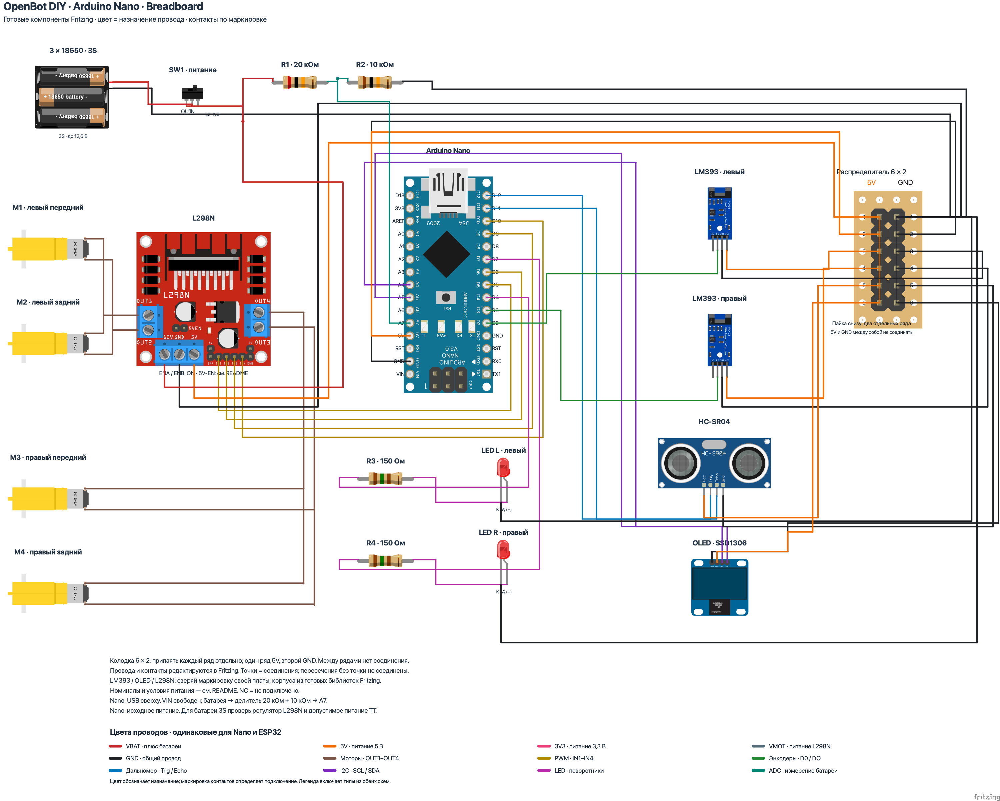
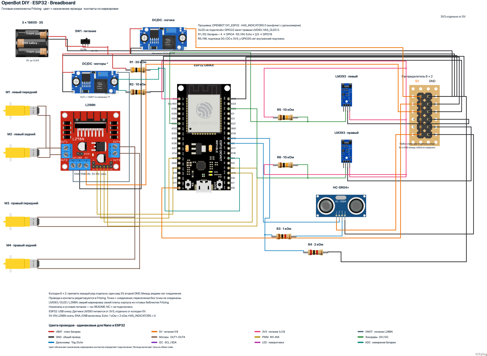

# OpenBot DIY: изображения плат во вкладке Breadboard

Открой нужный файл в Fritzing и выбери **Breadboard**. Изображения компонентов взяты из готовых библиотек Fritzing. Платы, контакты, резисторы и провода — отдельные редактируемые объекты. Все определения компонентов включены в `.fzz`.

| Контроллер | Файл Fritzing | Картинка | Векторное превью |
| --- | --- | --- | --- |
| Arduino Nano ATmega328P | [openbot-diy-nano-breadboard.fzz](openbot-diy-nano-breadboard.fzz) | [PNG](openbot-diy-nano-breadboard.png) | [SVG](openbot-diy-nano-breadboard_breadboard.svg) |
| ESP32 DevKit ESP-WROOM-32, 38 контактов | [openbot-diy-esp32-breadboard.fzz](openbot-diy-esp32-breadboard.fzz) | [PNG](openbot-diy-esp32-breadboard.png) | [SVG](openbot-diy-esp32-breadboard_breadboard.svg) |
| Arduino Nano, обычная беспаечная макетная плата | [openbot-diy-nano-on-breadboard.fzz](openbot-diy-nano-on-breadboard.fzz) | [PNG](openbot-diy-nano-on-breadboard.png) | [SVG](openbot-diy-nano-on-breadboard_breadboard.svg) |





## Как пользоваться

Arduino Nano показана **сверху, USB Mini-B вверх**. Порядок двух рядов контактов соответствует [официальной распиновке Nano](https://docs.arduino.cc/resources/pinouts/A000005-full-pinout.pdf). `D5` Arduino Nano соединён с `IN1` L298N, `D6` — с `IN2`, `D9` — с `IN3`, `D10` — с `IN4`. Контакт `VIN` Arduino Nano свободен; делитель батареи подключён к `A7` Arduino Nano.

ESP32 показана **сверху, USB вниз**. Порядок 38 контактов соответствует [ESP32-DevKitC](https://documentation.espressif.com/esp-dev-kits/en/latest/esp32/esp32-devkitc/user_guide.html#header-block). Подписи `IO13`, `IO12`, `IO15`, `IO2` на изображении ESP32 означают `GPIO13`, `GPIO12`, `GPIO15`, `GPIO2`; они соединены соответственно с `IN1`, `IN2`, `IN3`, `IN4` L298N. Подписи `SDx`, `CMD`, `CLK` относятся к выводам Flash — они свободны. У похожих плат с 30 или 36 контактами порядок другой.

L298N изображён с радиатором вверх, клеммами двигателей по бокам и разъёмом управления внизу; расположение групп соответствует [руководству Handson Technology](https://handsontec.com/dataspecs/L298N%20Motor%20Driver.pdf). Показаны готовые компоненты L298N, FC-03 с LM393, SSD1306 и LM2596. Масштаб разных модулей выбран для читаемости схемы. Перед монтажом сверяй **маркировку конкретной платы**, особенно порядок `VCC`, `GND`, `DO` / `D0`, `AO` / `A0` на LM393 и `VCC`, `GND`, `SCL`, `SDA` на OLED. Для LM393 с тремя контактами используются `VCC`, `GND`, `DO` / `D0`; аналоговый выход свободен.

Цвета совпадают с предыдущими схемами; [таблица цветов](WIRE-COLORS.ru-RU.md) описывает назначение проводов. Чёрный — `GND` (общий провод). Цветные точки отмечают электрические ответвления. Пересечение линий **без точки** не соединяет провода. `A (+)` и `K (−)` подписаны у выводов каждого светодиода. Цветовые полосы резисторов показывают номинал и допуск 1 %; номиналы также указаны текстом.

Условия питания и настройки прошивки описаны в [инструкции Nano](README.ru-RU.md) и [инструкции ESP32](README.esp32.ru-RU.md). Вариант Nano сохраняет питание исходной схемы, которое нужно проверить для батареи 3S и конкретных TT-моторов. В варианте ESP32 сохранены два DC/DC, делитель `Echo`, подтяжки LM393 к `3V3` и снятая перемычка `5V-EN` L298N. Перемычки `ENA` и `ENB` L298N установлены в обоих вариантах.

## Распределитель питания 6 × 2

Колодка соответствует [совету в инструкции DIY](../README.ru-RU.md): двухрядная штыревая колодка 6 × 2 установлена на перфорированной макетной плате. **Припаяй шесть контактов одного ряда друг к другу для `5V`, а шесть контактов второго ряда — для `GND`. Между рядами соединения нет.** Цветные пунктирные линии на компоненте показывают эти соединения на нижней стороне платы. Нумерация 1–6 относится к каждому ряду отдельно.

В варианте Nano контакт `5V` L298N соединён с `5V1` распределителя, а `GND` L298N — с `GND1`. Контакты `5V2`–`5V6` распределителя соединены соответственно с `5V` Arduino Nano, `VCC` левого FC-03, `VCC` правого FC-03, `VCC` HC-SR04 и `VCC` OLED. Контакты `GND2`–`GND6` распределителя соединены с `GND` этих же плат. `GND` батареи, R2 и светодиодов также подключён к цепи `GND`.

В варианте ESP32 контакт `OUT+` DC/DC логики соединён с `5V1` распределителя; `5V2`, `5V3`, `5V6` распределителя — с `5V` ESP32, `5V` L298N и `VCC` HC-SR04 соответственно. Контакты `5V4` и `5V5` свободны. Датчики FC-03 получают питание от `3V3` ESP32. Их `GND` соединён с общей цепью `GND` через второй ряд распределителя.

Для сборки на обычной беспаечной макетной плате есть [дополнительный вариант Nano](README.nano-on-breadboard.ru-RU.md): колодка заменена шинами макетной платы, а R1–R4 и два светодиода вставлены в её отверстия.

## Файлы и проверка

В новых файлах вкладка **Schematic** сохранена из соответствующей прежней схемы. Распределитель добавлен и в прежние `.fzz`; ручная компоновка Nano сохранена. Вариант до правок сохранён отдельным коммитом Git. Электрические цепи обоих видов совпадают: 37 у Nano и 45 у ESP32, включая свободные контакты. PNG и SVG экспортированы штатным Fritzing 1.0.8.

- `source-breadboard-nano/` и `source-breadboard-esp32/` содержат распакованные `.fz`, определения компонентов, SVG и `nets.json`.
- `generate_breadboard.py` создаёт оба варианта на основе прежних `.fzz`, проверяет назначения по прошивке, сравнивает электрические цепи каждого вида с исходными `nets.json` и проверяет сохранность Schematic.
- Каждая точка ответвления — отдельный контакт Fritzing, соединённый с проводами. Её можно перемещать вместе с подключёнными концами проводов.
- `validate_topology.py` независимо сравнивает все пять `.fzz` с коммитом до правок `12c12e5`. Проверка учитывает внутренние шины компонентов и макетной платы, свободные контакты, номиналы и полярность. Результат и контрольные суммы сохранены в `topology-validation.json`.

```sh
python3 body/diy/fritzing/add_distribution.py
python3 body/diy/fritzing/generate_breadboard.py
python3 body/diy/fritzing/generate_solderless.py
python3 body/diy/fritzing/validate_topology.py
```

Повторный запуск генераторов Breadboard заменяет новые `*-breadboard.fzz` и их распакованные исходники. Ручные правки сначала сохраняй отдельно. `generate_breadboard.py` и `generate_solderless.py` только читают прежние `openbot-diy-nano.fzz` и `openbot-diy-esp32.fzz`; `add_distribution.py` добавляет колодку в эти прежние файлы, сохраняя их компоновку.

## Источники компонентов

Created with [Fritzing](https://fritzing.org/). Схемы опубликованы по [CC BY-SA 3.0](https://creativecommons.org/licenses/by-sa/3.0/). Готовая графика адаптирована к существующим идентификаторам контактов и повёрнута вместе с точками подключения; соединения и номиналы сохранены. Отдельно добавлены читаемые подписи. Скрипты — на условиях лицензии OpenBot в корне репозитория.

| Компоненты | Источник | Автор и лицензия исходника |
| --- | --- | --- |
| Nano, HC-SR04, TT, LM2596, резисторы, LED, переключатель, макетная плата | [fritzing-parts](https://github.com/fritzing/fritzing-parts) | Fritzing и авторы соответствующих `.fzp`; CC BY-SA 3.0 |
| ESP32 MH-ET LIVE, 38 контактов | [Warlib1975](https://github.com/Warlib1975/Fritzing-parts) | Andrey Fedorov; MIT |
| OLED SSD1306, `GND` первым | [TD-er / squix78](https://github.com/TD-er/fritzing-parts/tree/master/OLED_SSD1306_I2C_128x64) | Daniel Eichhorn; MIT |
| L298N | [coderfls](https://github.com/coderfls/Fritzing-Parts) | Florian Schäffer; отдельная лицензия в исходном `.fzp` не указана |
| FC-03 | [публикация на форуме Fritzing](https://forum.fritzing.org/t/fc-03-ir-speed-sensor/5137/3) | Lucas Fernandes, исправления vanepp / Lukff; отдельная лицензия в `.fzp` не указана |
| Держатель 3 × 18650 | [публикация на форуме Fritzing](https://forum.fritzing.org/t/18650-battery-holder-part-design/6523/32) | revolt_randy / just_randy; отдельная лицензия в `.fzp` не указана |

Исходные `.fzp` и SVG, сведения об авторах, ссылки, контрольные суммы и предоставленные авторами лицензии сохранены в `library-parts/`. Условия исходных компонентов сохраняются; лицензия схемы не заменяет их. Графика колодки собрана из штатных шаблонов штыревого разъёма и перфорированной платы Fritzing.
