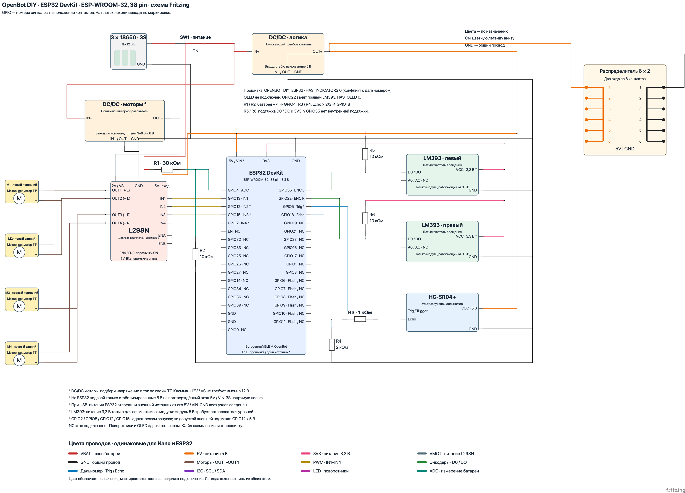

# Схема OpenBot DIY для ESP32 в Fritzing

Открой [openbot-diy-esp32.fzz](openbot-diy-esp32.fzz) в Fritzing, вкладка **Schematic**. Это отдельная схема для **ESP32 DevKit с ESP-WROOM-32, 38 контактов**, конфигурация `DIY_ESP32`. Компоненты, контакты и провода редактируются; все определения компонентов включены в `.fzz`.

Для вида с изображениями плат открой [отдельный файл Breadboard для ESP32](openbot-diy-esp32-breadboard.fzz). [Превью и пояснения](README.breadboard.ru-RU.md) показывают расположение контактов, USB-разъёма и клемм.



Цвета проводов различаются по назначению и совпадают со схемой Arduino Nano. Внизу рисунка есть цветная легенда; [таблица цветов](WIRE-COLORS.ru-RU.md) поясняет все типы цепей.

[Векторное превью](openbot-diy-esp32_schematic.svg) экспортировано из Fritzing. Выводы сгруппированы по функции: находи их на своей плате **по маркировке GPIO**, а не по расположению на рисунке. Это номера сигналов микроконтроллера, не порядковые номера контактов. Показаны все 38 контактов; свободные выводы обозначены `NC`. Во вкладке Breadboard используется тот же порядок. Посадочные места и разводка PCB не предусмотрены.

Назначения сверены с блоком `OPENBOT == DIY_ESP32` в [openbot.ino](../../../firmware/openbot/openbot.ino). В текущем исходнике выбран `OPENBOT DIY` для Arduino Nano. Файл схемы не переключает конфигурацию и не загружает прошивку.

| ESP32 DevKit | Другой конец соединения |
| --- | --- |
| `GPIO13` | L298N `IN1` |
| `GPIO12` | L298N `IN2` |
| `GPIO15` | L298N `IN3` |
| `GPIO2` | L298N `IN4` |
| `GPIO35` | Левый датчик частоты вращения LM393 `D0` / `DO`; подтяжка R5 **10 кОм** к ESP32 `3V3` |
| `GPIO22` | Правый датчик частоты вращения LM393 `D0` / `DO`; подтяжка R6 **10 кОм** к ESP32 `3V3` |
| `GPIO5` | Ультразвуковой дальномер HC-SR04+ `Trig` / `Trigger` |
| `GPIO18` | Средняя точка делителя R3 **1 кОм** / R4 **2 кОм**, снижающего сигнал HC-SR04+ `Echo` |
| `GPIO4` | Средняя точка делителя батареи R1 **30 кОм** / R2 **10 кОм** |
| `3V3` | `VCC` обоих LM393, если конкретные модули поддерживают питание 3,3 В; верхние выводы R5 и R6 |
| `5V` / `VIN` | Стабилизированные 5 В от преобразователя логики; используй только подтверждённый вход питания своей платы |
| `GND` | Общий провод (`GND`), соединённый с `GND` всех модулей и минусом батареи |

Два левых мотор-редуктора подключены параллельно: положительные провода к L298N `OUT1`, отрицательные к `OUT2`. Два правых подключены параллельно: положительные к `OUT4`, отрицательные к `OUT3`. Перемычки `ENA` и `ENB` установлены. Перемычка регулятора **5V-EN снята**, поскольку логика L298N получает внешние стабилизированные 5 В.

## Делители и уровни сигналов

Для обоих делителей используй резисторы с допуском **1 %**.

**Батарея:** плюс батареи после SW1 → R1 **30 кОм** → узел `GPIO4` ESP32 → R2 **10 кОм** → `GND`. Коэффициент 4 соответствует `VOLTAGE_DIVIDER_FACTOR` в `DIY_ESP32`: при 12,6 В на батарее на входе получится 3,15 В. Это измерительная цепь; она не питает ESP32. Показания АЦП требуют проверки и калибровки по мультиметру.

**Echo:** HC-SR04+ `Echo` → R3 **1 кОм** → узел `GPIO18` ESP32 → R4 **2 кОм** → `GND`. При сигнале 5 В на входе ESP32 получится около 3,33 В. HC-SR04+ `VCC` подключён к стабилизированным 5 В, `GND` — к общему проводу (`GND`). Это отдельный делитель, не делитель батареи.

**LM393:** схема показывает питание обоих модулей от ESP32 `3V3` и подтяжки R5/R6 к той же цепи. `A0` / `AO` оставлены свободными. Если у датчика три контакта, используй `VCC`, `GND` и `D0` / `DO`. Проверь, что конкретный модуль работает от 3,3 В. Если ему нужны 5 В, потребуется другая цепь питания и согласователь уровней на `D0` / `DO`; напрямую к GPIO такой выход подключать нельзя. Характеристики самой микросхемы LM393 не подтверждают совместимость всей платы датчика.

**Техническое уточнение к схеме Nano:** GPIO ESP32 допускают максимум 3,6 В; поэтому цепи с сигналами 5 В нельзя переносить напрямую. Это указано в [ESP-FAQ Espressif](https://docs.espressif.com/projects/esp-faq/en/latest/hardware-related/hardware-design.html#what-is-the-voltage-tolerance-of-gpios-of-esp-chips). На `GPIO35` нет внутренней подтяжки, даже если код задаёт `INPUT_PULLUP`; см. [описание GPIO ESP32](https://docs.espressif.com/projects/esp-idf/en/stable/esp32/api-reference/peripherals/gpio.html). R5 обеспечивает внешнюю подтяжку. LM393 имеет выход с открытым коллектором, согласно [Texas Instruments](https://www.ti.com/product/LM393-N); встроенная подтяжка модуля при его питании 3,3 В может работать параллельно с показанной внешней.

## Питание

На схеме предусмотрены два понижающих преобразователя с общим проводом (`GND`):

- **DC/DC логики:** `IN+` → плюс батареи после SW1; `OUT+` → стабилизированные 5 В для ESP32 `5V` / `VIN`, L298N `5V` и HC-SR04+ `VCC`. Настрой выход по мультиметру до подключения плат.
- **DC/DC моторов:** `IN+` → плюс батареи после SW1; `OUT+` → L298N `+12V` / `VS`. Напряжение выбери по номиналу своих мотор-редукторов; для TT на 3–6 В выход не выше 6 В. Ток преобразователя подбери по суммарному пусковому току четырёх двигателей. Учти падение напряжения на L298N.
- `IN−` и `OUT−` обоих преобразователей → общий провод (`GND`), соединённый с минусом батареи и `GND` всех плат. Показаны обычные неизолированные преобразователи, у которых `IN−` и `OUT−` электрически соединены.

**Техническое уточнение:** маркировка L298N `+12V` не означает, что нужно подавать ровно 12 В. Батарея 3S достигает 12,6 В, поэтому на схеме показано отдельное питание моторов через преобразователь. Отдельное питание логики требует снятой перемычки **5V-EN** стандартного модуля; это описано в [руководстве Handson Technology](https://handsontec.com/dataspecs/L298N%20Motor%20Driver.pdf). Назначение перемычки проверь на своей плате. Уровни управления 3,3 В совместимы с входами L298: минимальный высокий уровень 2,3 В по [документации STMicroelectronics](https://www.st.com/resource/en/datasheet/l298.pdf).

Батарею 3S напрямую к ESP32 `5V`, `VIN` или `3V3` не подключай. При питании ESP32 по USB отсоедини внешний источник от его `5V` / `VIN`; общий провод (`GND`) оставь соединённым. Espressif требует использовать один способ питания в [руководстве DevKitC](https://documentation.espressif.com/esp-dev-kits/en/latest/esp32/esp32-devkitc/user_guide.html#power-supply-options). В этой схеме телефон связывается с ESP32 через встроенный BLE; отдельный HC-05 не предусмотрен.

## Настройки и конфликты в исходной прошивке

Перед использованием этой схемы в блоке `DIY_ESP32` должны быть такие настройки:

```cpp
#define OPENBOT DIY_ESP32
// В блоке OPENBOT == DIY_ESP32:
#define HAS_INDICATORS 0
#define HAS_SONAR 1
#define HAS_SPEED_SENSORS_FRONT 1
#define HAS_VOLTAGE_DIVIDER 1
#define HAS_OLED 0
```

`HAS_INDICATORS` в исходнике сейчас равен `1`: **для этой схемы его нужно изменить на `0`**, поскольку `PIN_LED_LI` совпадает с `PIN_TRIGGER` (`GPIO5`), а `PIN_LED_RI` — с `PIN_ECHO` (`GPIO18`). Поворотники на рисунке не подключены. Стандартный I2C OLED использовал бы `GPIO21` / `GPIO22`; `GPIO22` занят правым LM393, поэтому OLED здесь отключён. Подключение OLED или поворотников вместе с датчиками потребует согласованного изменения назначения GPIO и кода.

Если конкретный датчик или делитель ещё не установлен, отключи соответствующий `HAS_SONAR`, `HAS_SPEED_SENSORS_FRONT` или `HAS_VOLTAGE_DIVIDER`. Задние датчики и дополнительные светодиоды не показаны и остаются отключёнными. Диски на 20 прорезей соответствуют `TICKS_PER_REV = 20`.

`GPIO2`, `GPIO5`, `GPIO12`, `GPIO15` участвуют в выборе режима запуска ESP32. В частности, высокий уровень на `GPIO12` при включении выбирает питание Flash 1,8 В вместо 3,3 В и может помешать запуску ESP-WROOM-32. На входах L298N не должно быть внешней подтяжки к 5 В. Если плата с подключённым драйвером не запускается, проверь его входные цепи и уровни при сбросе; перенос GPIO выполняй вместе с изменением прошивки. См. раздел Strapping Pins в [документации ESP32](https://www.espressif.com/sites/default/files/documentation/esp32_datasheet_en.pdf).

## Исходники и воспроизведение

- `openbot-diy-esp32.fzz` — основной переносимый файл Fritzing.
- `source-esp32/openbot-diy-esp32.fz` — распакованная XML-схема.
- `source-esp32/parts/` — определения компонентов и SVG; идентификаторы отличаются от схемы Nano.
- `source-esp32/nets.json` — проверенные электрические цепи, включая свободные выводы.
- `generate_esp32.py` — генератор на стандартной библиотеке Python.

```sh
python3 body/diy/fritzing/generate_esp32.py
```

Генератор проверяет GPIO по независимым определениям прошивки, параллельное подключение моторов, разделение `VBAT`, `VMOT`, `5V`, `3V3`, `GND`, входов АЦП и двух сторон делителя `Echo`. После ручного редактирования `.fzz` генератор восстановит исходную компоновку; сначала сохрани свою версию отдельно.

Created with [Fritzing](https://fritzing.org/). Принципиальная схема и её собственная графика распространяются по [CC BY-SA 3.0](https://creativecommons.org/licenses/by-sa/3.0/), основаны на документации OpenBot. Скрипт — на условиях лицензии OpenBot в корне репозитория.

Распределитель питания 6 × 2 добавлен согласно инструкции DIY; его ряды `5V` и `GND` изолированы друг от друга. [Пояснения к колодке и источники графики Breadboard](README.breadboard.ru-RU.md).
