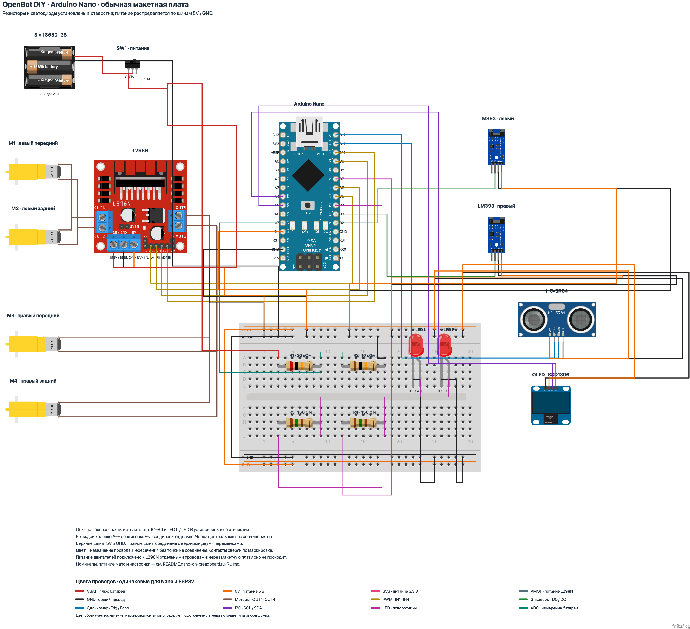

# OpenBot DIY: Arduino Nano с обычной макетной платой

Открой [openbot-diy-nano-on-breadboard.fzz](openbot-diy-nano-on-breadboard.fzz) в Fritzing и выбери **Breadboard**. Четыре резистора и два светодиода установлены в отверстия беспаечной макетной платы; питание распределяется по её шинам. [PNG](openbot-diy-nano-on-breadboard.png) и [SVG](openbot-diy-nano-on-breadboard_breadboard.svg) экспортированы из Fritzing 1.0.8.



Этот дополнительный вариант сохраняет соединения [схемы Nano](README.ru-RU.md). Варианты с [распределителем питания 6 × 2](README.breadboard.ru-RU.md) доступны отдельно. Изображения компонентов взяты из готовых библиотек Fritzing; определения включены в `.fzz`.

## Отверстия и внутренние соединения

В каждой колонке с номером 1–30 отверстия `A`–`E` соединены между собой; отверстия `F`–`J` соединены отдельной группой. Между группами через центральный паз соединения нет. Например, `B9` соединено с `A9` и `C9`, но не с `H9` или `B12`.

Шины подписаны на рисунке: сверху `W · 5V` и `X · GND`, снизу `Y · GND` и `Z · 5V`. В использованной модели каждая шина непрерывна. Если на твоей макетной плате шины разделены посередине, соедини соответствующие половины перемычками.

| Компонент | Номинал | Первый вывод → отверстие | Второй вывод → отверстие |
| --- | --- | --- | --- |
| R1 | 20 кОм | `1` → `B3` | `2` → `B9` |
| R2 | 10 кОм | `1` → `B12` | `2` → `B18` |
| R3 | 150 Ом | `1` → `H3` | `2` → `H9` |
| R4 | 150 Ом | `1` → `H12` | `2` → `H18` |
| Левый светодиод LED L | — | Катод `K (−)` → `E22` | Анод `A (+)` → `E23` |
| Правый светодиод LED R | — | Катод `K (−)` → `E26` | Анод `A (+)` → `E27` |

`1` и `2` здесь — обозначения выводов резистора в файле; у обычного резистора полярности нет. У светодиодов соблюдай обозначения `A (+)` и `K (−)`.

## Питание и перемычки

| Плата и её контакт | Отверстие макетной платы |
| --- | --- |
| L298N `5V` | `W1` |
| Arduino Nano `5V` | `W7` |
| Левый FC-03 `VCC` | `W13` |
| Правый FC-03 `VCC` | `W19` |
| HC-SR04 `VCC` | `W25` |
| OLED SSD1306 `VCC` | `W29` |
| L298N `GND` | `X1` |
| Arduino Nano `GND` | `X7` |
| Левый FC-03 `GND` | `X13` |
| Правый FC-03 `GND` | `X19` |
| HC-SR04 `GND` | `X25` |
| OLED SSD1306 `GND` | `X29` |
| Минус батареи `GND` | `X3` |

Соедини `W5` с `Z5` для питания нижней шины `5V`, а `X5` с `Y5` — для нижней шины `GND` (общий провод). Эти перемычки показаны слева от макетной платы.

Цепь питания Nano и перемычки L298N сохранены из исходной схемы. Условия питания от батареи 3S, встроенного регулятора L298N и USB описаны в [инструкции Nano](README.ru-RU.md#технические-уточнения). Питание двигателей и провода `OUT1`–`OUT4` идут непосредственно к L298N отдельными проводами.

## Делитель батареи и светодиоды

| Откуда | Куда | Назначение |
| --- | --- | --- |
| Выход переключателя SW1 `OUT` | `A3` макетной платы | Плюс батареи после выключателя → R1 |
| `A9` макетной платы | `A12` макетной платы | Соединение R1 и R2 |
| Arduino Nano `A7` | `C9` макетной платы | Измерение средней точки делителя |
| `A18` макетной платы | `X17` макетной платы | R2 → `GND` |
| Arduino Nano `D4` | `J3` макетной платы | Выход левого светодиода → R3 |
| `J9` макетной платы | `D23` макетной платы | R3 → анод LED L |
| `D22` макетной платы | `Y25` макетной платы | Катод LED L → `GND` |
| Arduino Nano `D7` | `J12` макетной платы | Выход правого светодиода → R4 |
| `J18` макетной платы | `D27` макетной платы | R4 → анод LED R |
| `D26` макетной платы | `Y29` макетной платы | Катод LED R → `GND` |

Назначения остальных контактов Arduino Nano, датчиков и двигателей приведены в [общей таблице Nano](README.ru-RU.md). `D5`, `D6`, `D9`, `D10` Arduino Nano соединены соответственно с `IN1`, `IN2`, `IN3`, `IN4` L298N. `VIN` Arduino Nano свободен. Цвета проводов совпадают со всеми остальными схемами: [таблица цветов](WIRE-COLORS.ru-RU.md).

## Проверка и исходники

[validate_topology.py](validate_topology.py) независимо читает соединения и внутренние шины из `.fzz` и сравнивает все пять вариантов с коммитом `12c12e5ca1e4a3876535533e984bed702a1f8db9`. Проверка включает свободные контакты, номиналы, внутренние соединения компонентов и полярность светодиодов. Для каждого вида Nano совпадают 37 цепей и 83 исходных контакта; для ESP32 — 45 цепей и 93 контакта. [Результат проверки](topology-validation.json) содержит контрольные суммы файлов.

У макетной платы сохранены все 68 внутренних шин штатного компонента Fritzing. Отдельно проверены совпадение координат всех 12 установленных выводов с отверстиями, электрические контакты с ними, отсутствие перемычек поперёк резисторов и прямого соединения `5V` с `GND`.

Во вкладке **Schematic** сохранена принципиальная схема Nano без отдельной колодки; макетная плата представлена соединениями тех же цепей во вкладке **Breadboard**. `source-nano-on-breadboard/` содержит распакованную схему, определения компонентов, SVG и `nets.json`.

Для повторной генерации и проверки из корня репозитория:

```sh
python3 body/diy/fritzing/generate_solderless.py
python3 body/diy/fritzing/validate_topology.py
```

Генерация заменяет этот `.fzz` и его распакованные исходники. Ручные правки сначала сохраняй отдельно. Экспорт PNG/SVG выполняется отдельно штатным Fritzing.

Created with [Fritzing](https://fritzing.org/). Авторы, источники компонентов и условия лицензирования приведены в [общих пояснениях Breadboard](README.breadboard.ru-RU.md#источники-компонентов).
