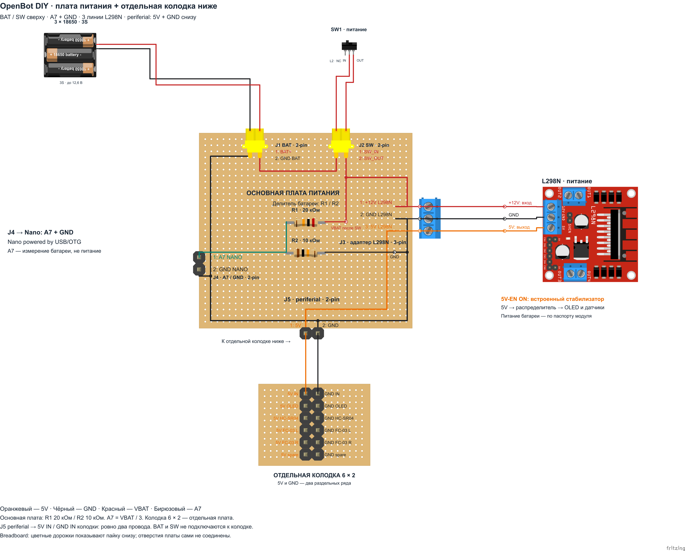

# Плата питания и отдельная распределительная колодка

[Открыть один файл Fritzing](openbot-diy-power-hub.fzz). **Основная плата питания сверху, распределительная колодка на отдельной плате ниже.** Обе платы и провода между ними находятся в одном `.fzz`, во вкладках **Breadboard** и **Schematic**.

[Принципиальная схема](openbot-diy-power-hub-schematic.png). Изображения получены из штатного экспорта Fritzing 1.0.8 через Inkscape. Все компоненты, их графика, контакты и провода включены в `.fzz`.

## Что находится на основной плате

- **Сверху:** `J1 BAT` для батарейного блока и `J2 SW` для выключателя, каждый на два контакта. У `J2 SW` контакт `SW_IN` слева, `SW_OUT` справа; провод от `BAT+` не пересекает линию после выключателя.
- **Справа:** `J3` — три линии адаптера L298N: `+12V`, `GND`, `5V`.
- **Слева:** `J4` — два выхода к Nano: `A7` и `GND`.
- **Снизу:** `J5 periferial` — только два контакта, `5V` слева и `GND` справа, для кабеля к отдельной колодке.
- **По центру:** резисторы делителя батареи R1 **20 кОм** и R2 **10 кОм**, расположенные один под другим параллельно друг другу. Верхний R1 отражён относительно вертикальной оси: его контакт `1` справа, контакт `2` слева. Контакты `R1.2` и `R2.1` соединены коротким вертикальным проводом.

На основной плате нет колодки с индивидуальными выходами OLED / HC-SR04 / FC-03. Эти выходы находятся на отдельной плате ниже. Между двумя платами проходят **ровно два провода**: оранжевый `5V` и чёрный `GND`. Подпись `periferial` сохранена в указанном написании. Фоны подписей прозрачны.

## Контакты и другой конец провода

| Разъём / контакт основной платы | Имя контакта в Fritzing | Другой конец провода |
| --- | --- | --- |
| `J1.1` | `BAT+` | Плюс батарейного блока |
| `J1.2` | `GND BAT` | Минус батарейного блока (`GND`) |
| `J2.1` | `SW_IN` | `IN` / `COM` выключателя `SW1` |
| `J2.2` | `SW_OUT` | `OUT` / выбранный переключаемый контакт выключателя `SW1` |
| `J3.1` | `VBAT L298N` | `+12V` L298N — питание батареи после выключателя |
| `J3.2` | `GND L298N` | `GND` L298N |
| `J3.3` | `5V L298N` | `5V` L298N — **выход** встроенного стабилизатора при `5V-EN ON` |
| `J4.1` | `A7 NANO` | `A7` Arduino Nano — средняя точка делителя |
| `J4.2` | `GND NANO` | `GND` Arduino Nano |
| `J5.1` | `5V periferial` | `5V IN` отдельной колодки |
| `J5.2` | `GND periferial` | `GND IN` отдельной колодки |
| Внутренняя точка пайки | `VBAT R1` | Контакт `1` R1 20 кОм |
| Внутренняя точка пайки | `GND R2` | Контакт `2` R2 10 кОм |

Основная плата содержит **11 внешних контактов и две внутренние точки пайки**. Пара `A7 NANO` / `GND NANO` расположена сверху вниз; пара `5V periferial` / `GND periferial` — слева направо. Точные номера и назначения остальных контактов указаны около соответствующих разъёмов.

**У `J2 SW` оба провода находятся в цепи плюса батареи; контакта `GND` там нет.** Используй выключатель или кнопку с фиксацией. На рисунке подключены `COM` и один переключаемый контакт; второй контакт `L2` свободен.

## Отдельная колодка ниже

Колодка 6 × 2 установлена на собственной перфорированной макетной плате. Отверстия платы сами между собой не соединены: припаяй шесть контактов одного ряда друг к другу для `5V`, а шесть контактов другого ряда — для `GND`. Между рядами соединения нет. Цветные дорожки в Breadboard показывают эту пайку снизу.

| Пара сверху вниз | Левый контакт | Правый контакт | Подключение |
| --- | --- | --- | --- |
| 1 | `5V IN` | `GND IN` | Два провода от `J5 periferial` основной платы |
| 2 | `5V OLED` | `GND OLED` | `VIN` / `VCC` и `GND` OLED-дисплея |
| 3 | `5V HC-SR04` | `GND HC-SR04` | `VCC` и `GND` HC-SR04 |
| 4 | `5V FC-03 L` | `GND FC-03 L` | `VCC` и `GND` левого FC-03 |
| 5 | `5V FC-03 R` | `GND FC-03 R` | `VCC` и `GND` правого FC-03 |
| 6 | `5V spare` | `GND spare` | Запасная пара, кабель не подключён |

При отсоединении кабеля `J5` колодка изолируется от основной платы. Батарея, выключатель и измерительный выход `A7` к колодке не подключаются.

## Внутренние цепи и делитель

| Цепь основной платы | Соединённые контакты |
| --- | --- |
| Плюс до выключателя | `BAT+`, `SW_IN` |
| Плюс после выключателя | `SW_OUT`, `VBAT L298N`, `VBAT R1` |
| Общий `GND` | `GND BAT`, `GND L298N`, `GND NANO`, `GND periferial`, `GND R2` |
| Стабилизированные 5 В от L298N | `5V L298N`, `5V periferial` |

Путь питания: **батарея `+` → `BAT+` → `SW_IN` → `SW1` → `SW_OUT` → `VBAT L298N` → `+12V` L298N**. Выход `5V` L298N → `5V L298N` основной платы → `J5.1 5V periferial` → `5V IN` отдельной колодки → OLED и датчики. При `OFF` или отсоединении `SW1` плюс батареи отключается от L298N и R1; общий `GND` остаётся соединённым. Цепи `VBAT` и `5V` внутри основной платы изолированы; плата не снижает напряжение.

Делитель находится на основной плате: `VBAT R1` после выключателя → R1.1; R1.2 → R2.1 и `A7 NANO`; R2.2 → `GND R2`. Резисторы — отдельные редактируемые компоненты, соединения выполнены настоящими проводами Fritzing, без шины в обход резистора. **A7 = VBAT × 10 / (20 + 10) = VBAT / 3**: при 12,6 В на батарее получается 4,2 В на `A7`.

Nano питается по **USB/OTG**; её `5V` и `VIN` свободны. `A7` только измеряет напряжение. Этот делитель заменяет внешние R1 / R2 из [полной схемы Nano](openbot-diy-nano.fzz): второй делитель параллельно `A7` не подключай.

## Режим питания L298N

**Техническое уточнение.** Здесь показан режим с установленной перемычкой **`5V-EN`**: `5V` L298N работает как **выход** встроенного стабилизатора. При снятой перемычке этот контакт становится входом внешних 5 В; показанное направление питания тогда не применяется. Назначение контакта описано в [руководстве Handson Technology](https://handsontec.com/dataspecs/L298N%20Motor%20Driver.pdf).

В том же руководстве встроенный источник разрешён при питании ниже 12 В. Показанный батарейный блок 3S достигает **12,6 В**, поэтому перед сборкой проверь допустимое напряжение своего конкретного модуля. Если его руководство требует внешний DC/DC для 3S, используй соответствующий вариант питания из [инструкции Nano](README.ru-RU.md#технические-уточнения): он требует иной схемы источника `5V`. Условия работы стабилизатора не меняются от добавления распределителя.

Силовой ток всех мотор-редукторов проходит через `J1`, `J2`, контакт `J3.1`, контакт `J3.2`, провода и выключатель. Выбирай их по пусковому току моторов. В изображении `J1` / `J2` использованы силовые разъёмы XT30, а для `J3` — готовая графика трёхконтактной винтовой колодки. Положение деталей служит для чтения соединений; производственная разводка PCB не предусмотрена.

## Проверка и источники

[validate_topology.py](validate_topology.py) проверяет 13 электрических контактов основной платы и 12 контактов отдельной колодки, четыре внутренние цепи основной платы и два изолированных ряда колодки. Проверка подтверждает:

- `BAT` и `SW` расположены сверху, `periferial` — снизу основной платы;
- колодка находится на отдельной плате ниже и подключена ровно двумя проводами `5V` / `GND`;
- при отсоединении этих двух проводов колодка изолируется;
- L298N подключён ровно тремя линиями, Nano получает только `A7` / `GND`;
- R1 20 кОм и R2 10 кОм находятся на основной плате; цепь `VBAT → R1 → A7 → R2 → GND` сохранена без обхода резисторов;
- `SW OFF` и отсоединённый выключатель разрывают питание L298N / R1;
- Breadboard и Schematic имеют одинаковую топологию, которая совпадает со схемой до переноса выходов на отдельную колодку.

[Отчёт](topology-validation.json). Для сравнения используется схема питания из коммита `8d51688`; четыре полные схемы Nano / ESP32 сравниваются с `12c12e5`, с исправлением ранее добавленного лишнего провода Nano `5V`.

Created with [Fritzing](https://fritzing.org/). Собственная графика и схема — [CC BY-SA 3.0](https://creativecommons.org/licenses/by-sa/3.0/). Изображения батарейного блока, выключателя, L298N, резисторов и штыревых контактов взяты из включённых в репозиторий [готовых компонентов](README.breadboard.ru-RU.md#источники-компонентов). Изображение XT30PW-F — компонент [Peter Van Epp / vanepp](https://forum.fritzing.org/t/need-part-for-xt30-pcb-connector/32430/2); отдельная лицензия в его `.fzp` не указана. Сведения об источниках и контрольные суммы сохранены в [sources.json](library-parts/sources.json).
