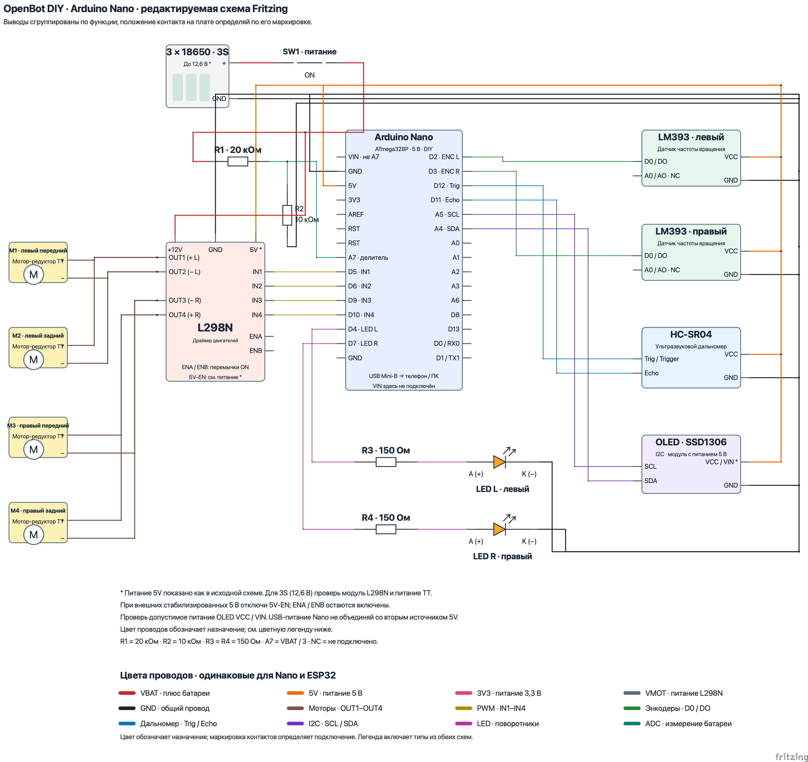

# Схема OpenBot DIY для Arduino Nano в Fritzing

Открой [openbot-diy-nano.fzz](openbot-diy-nano.fzz) в Fritzing и выбери вкладку **Schematic**. В файле находятся отдельные редактируемые компоненты, контакты и провода. Все необходимые определения компонентов и SVG включены в `.fzz`; скачивать библиотеку модулей отдельно не требуется.

Для вида с изображениями плат открой [отдельный файл Breadboard для Nano](openbot-diy-nano-breadboard.fzz). [Превью и пояснения](README.breadboard.ru-RU.md) показывают расположение контактов, USB-разъёма и клемм.



[Векторное превью схемы](openbot-diy-nano_schematic.svg) экспортировано из Fritzing 1.0.8. На PNG можно нажать, чтобы рассмотреть подписи в полном размере.

Цвета проводов различаются по назначению и совпадают со схемой ESP32. Внизу рисунка есть цветная легенда; [таблица цветов](WIRE-COLORS.ru-RU.md) поясняет все типы цепей.

Схема перерисована по [исходному изображению](../../../docs/images/wiring_diagram.png), [инструкции DIY](../README.ru-RU.md) и блоку `OPENBOT == DIY` в [прошивке](../../../firmware/openbot/openbot.ino). Подписаны оба конца соединений, полярность светодиодов и номиналы резисторов. Положение выводов сгруппировано по функции, чтобы провода можно было проследить. При монтаже находи контакт на своей плате **по маркировке**, а не по его положению в этом рисунке. Во вкладке Breadboard используется тот же порядок выводов. Посадочные места и разводка PCB в этом файле не предусмотрены.

| Arduino Nano | Другой конец соединения |
| --- | --- |
| `D5` | L298N `IN1` |
| `D6` | L298N `IN2` |
| `D9` | L298N `IN3` |
| `D10` | L298N `IN4` |
| `D2` | Левый датчик частоты вращения LM393 `D0` / `DO` |
| `D3` | Правый датчик частоты вращения LM393 `D0` / `DO` |
| `D12` | Ультразвуковой дальномер HC-SR04 `Trig` / `Trigger` |
| `D11` | Ультразвуковой дальномер HC-SR04 `Echo` |
| `A5` | OLED-дисплей SSD1306 `SCL` |
| `A4` | OLED-дисплей SSD1306 `SDA` |
| `D4` | R3 **150 Ом** → анод `A` левого светодиода; катод `K` → `GND` |
| `D7` | R4 **150 Ом** → анод `A` правого светодиода; катод `K` → `GND` |
| `A7` | Средняя точка делителя R1 **20 кОм** / R2 **10 кОм** |
| `5V` | Питание датчиков `VCC` и OLED-дисплея `VCC` / `VIN`, если модуль допускает 5 В |
| `GND` | Общий провод (`GND`) всех плат и минус аккумуляторной батареи |

R1 включён между плюсом батареи **после SW1** и `A7`. R2 включён между `A7` и `GND`. Это измерительная цепь: `A7 = VBAT / 3`, то есть 4,2 В при напряжении батареи 12,6 В. Контакт питания Nano `VIN` оставлен свободным; он не является входом этого делителя.

Два левых мотор-редуктора подключены параллельно: положительные провода к L298N `OUT1`, отрицательные к `OUT2`. Два правых подключены параллельно: положительные к `OUT4`, отрицательные к `OUT3`, как в инструкции DIY. `A0` / `AO` датчиков частоты вращения не подключены. Если у твоего датчика только три контакта, используй `VCC`, `GND` и `D0` / `DO`.

## Технические уточнения

Назначение контактов управления взято из блока `DIY` прошивки: `PIN_PWM_L1=5`, `PIN_PWM_L2=6`, `PIN_PWM_R1=9`, `PIN_PWM_R2=10`, `PIN_LED_LI=4`, `PIN_LED_RI=7`. На новой схеме показаны четыре линии `IN1`–`IN4`; `ENA` и `ENB` имеют установленные перемычки. Они отличаются от перемычки регулятора питания **5V-EN**.

Цепь питания `5V` перерисована как в исходном изображении: она соединяет L298N, Nano и датчики. Это не подтверждает пригодность встроенного регулятора конкретной платы L298N для полностью заряженной батареи 3S (12,6 В) или пригодность твоих мотор-редукторов TT для такого питания. Для внешнего стабилизированного источника 5 В на стандартном модуле L298N следует отключить **5V-EN**, оставив перемычки **ENA/ENB**. Перед монтажом проверь документацию своей платы. При питании Nano по USB отсоедини второй источник от цепи `5V`, чтобы источники не питали друг друга.

В исходной текстовой инструкции питание OLED названо `VIN`, а на изображении — `VCC`. На новой схеме показаны оба варианта маркировки; подключение к 5 В допустимо только для OLED-модуля, рассчитанного на 5 В. Это не означает, что `VIN` и `VCC` взаимозаменяемы на любой плате.

В текущей прошивке `DIY` дополнительные функции изначально выключены: `HAS_VOLTAGE_DIVIDER`, `HAS_INDICATORS`, `HAS_SONAR`, `HAS_SPEED_SENSORS_FRONT`, `HAS_OLED` равны `0`. После установки нужных компонентов включи соответствующие функции и загрузи обновлённую прошивку. Сам файл Fritzing прошивку не меняет.

## Исходники и воспроизведение

- `openbot-diy-nano.fzz` — основной переносимый файл для открытия и редактирования.
- `source/openbot-diy-nano.fz` — распакованная XML-схема для просмотра изменений в Git.
- `source/parts/` — определения компонентов `.fzp` и SVG для обоих видов.
- `source/nets.json` — проверенный список электрических цепей, включая свободные выводы.
- `generate.py` — воспроизводимая генерация схемы средствами стандартной библиотеки Python.

Для повторной генерации выполни из корня репозитория:

```sh
python3 body/diy/fritzing/generate.py
```

Генератор проверяет назначения контактов по прошивке, отсутствие прямого соединения между `VBAT`, `5V`, `GND` и `A7`, полярность светодиодов, соединение двух двигателей с каждой стороны и электрическую связность проводов. После ручного редактирования `.fzz` в Fritzing не запускай генератор поверх своего файла: он восстановит исходную компоновку.

В текущем `.fzz` сохранены перемещения компонентов во вкладке Breadboard из открытого окна Fritzing при обновлении цветов. Во вкладке Schematic используется компоновка с разнесёнными сигнальными линиями. Обе записаны в `source/openbot-diy-nano.fz`; генератор создаёт базовую компоновку и при запуске заменит ручные правки Breadboard.

Created with [Fritzing](https://fritzing.org/). Схема и графика этой папки распространяются по [CC BY-SA 3.0](https://creativecommons.org/licenses/by-sa/3.0/); основаны на документации OpenBot. Скрипт генерации распространяется на условиях лицензии OpenBot, указанной в корне репозитория.
